# UI

A collection of my small front-end projects: website templates, single-component designs and a few small apps. Each one used to live in its own repository and was merged here with its full commit history.

  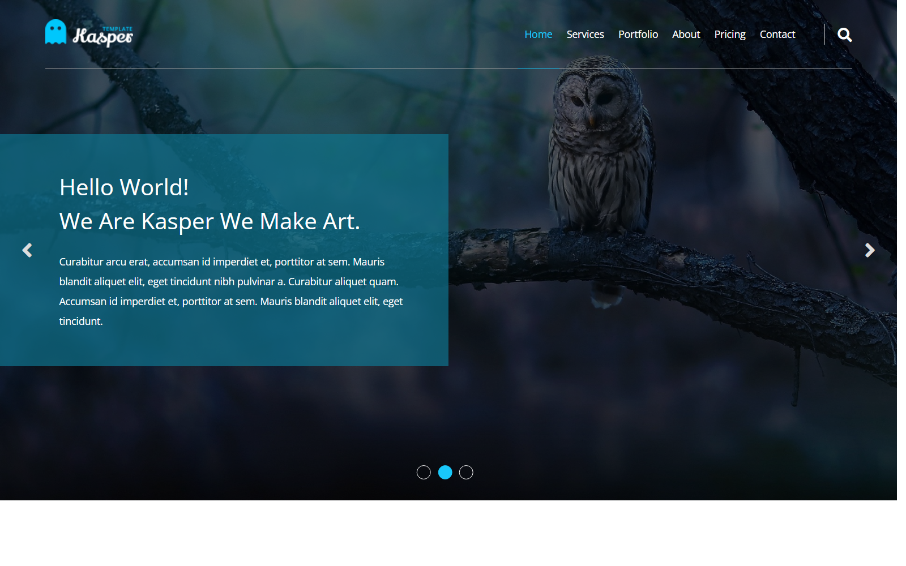
  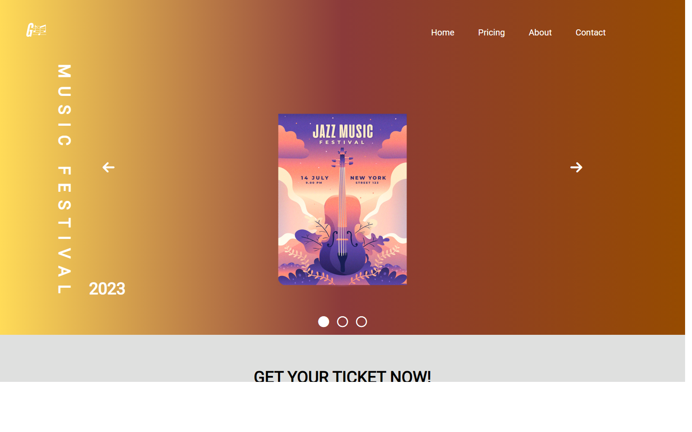
  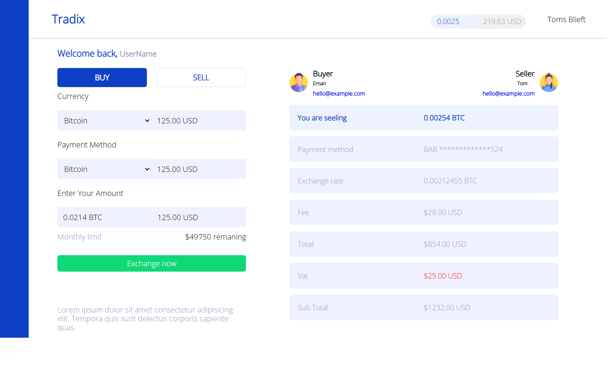

## Index

- [Templates](#templates): full web pages and landing pages
- [Components](#components): single components, cards and forms
- [Apps](#apps): small React, Vue and Next.js applications

Static projects open straight from `index.html`. Apps need `npm install` followed by `npm start` (or `npm run dev` for Vite projects) from inside their folder.

---

## Templates

| Preview | Project | Summary | Stack |
|---|---|---|---|
|  | [Kasper-Template](templates/Kasper-Template) | Agency one-pager with a full-screen image slider, services, portfolio, pricing and contact sections. | HTML, CSS, JS |
| 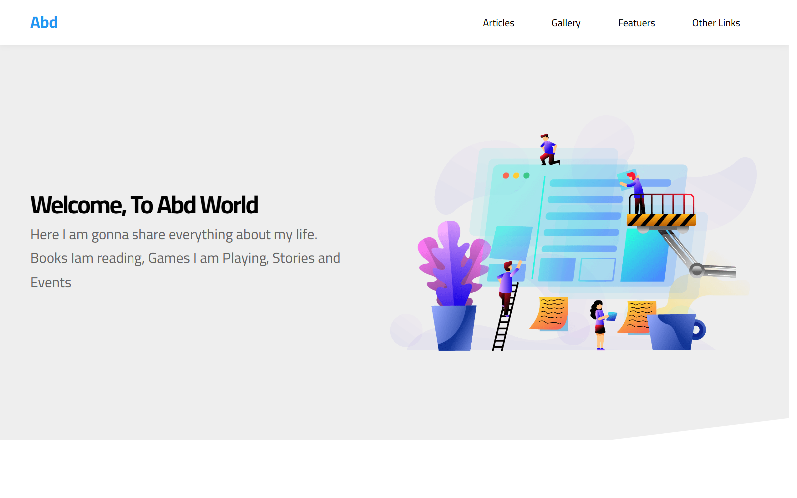 | [Elzero-Template](templates/Elzero-Template) | Landing page with welcome, articles, gallery, features and quality sections, built while following the Elzero web design course. | HTML, CSS, JS |
| 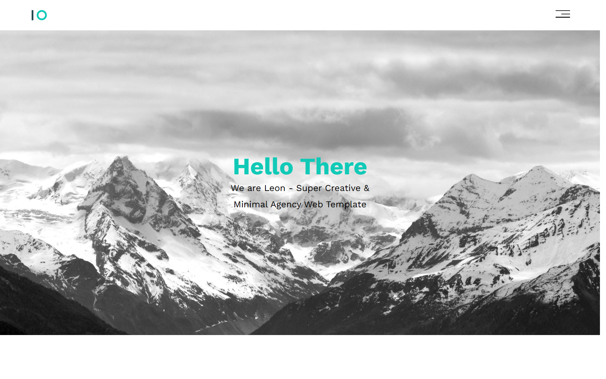 | [Leon-Template](templates/Leon-Template) | Responsive one-page template with hero, services, portfolio, about and contact sections. | HTML, CSS |
|  | [Music-Website](templates/Music-Website) | Music Festival 2023 site with ticket, story, testimonials, newsletter and contact sections. | HTML, CSS, JS |
| 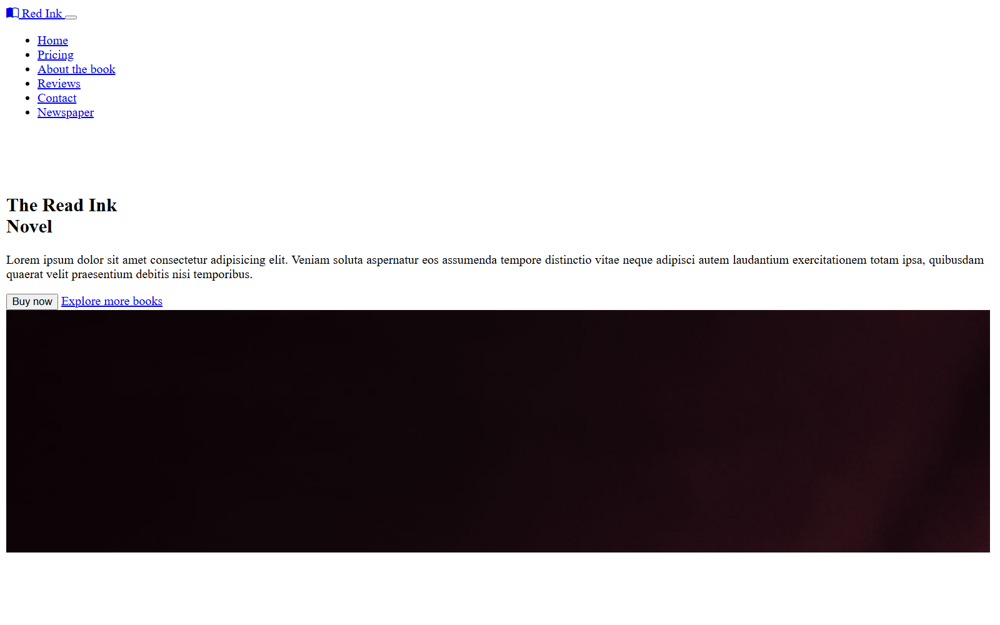 | [Book-Website](templates/Book-Website) | "The Mystery Box" book promotion site, styled with Sass. | HTML, Sass |
| 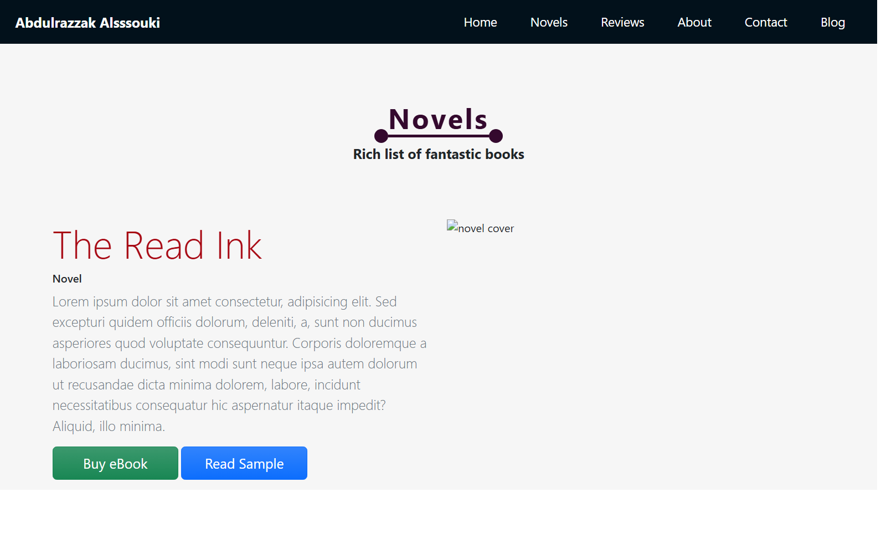 | [Writer-website](templates/Writer-website) | Author website with novels, reviews, about and contact sections. | HTML, Sass, JS |
| 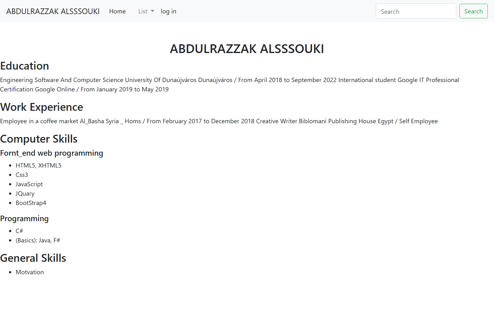 | [Web](templates/Web) | Blog page template. | HTML, CSS |
| 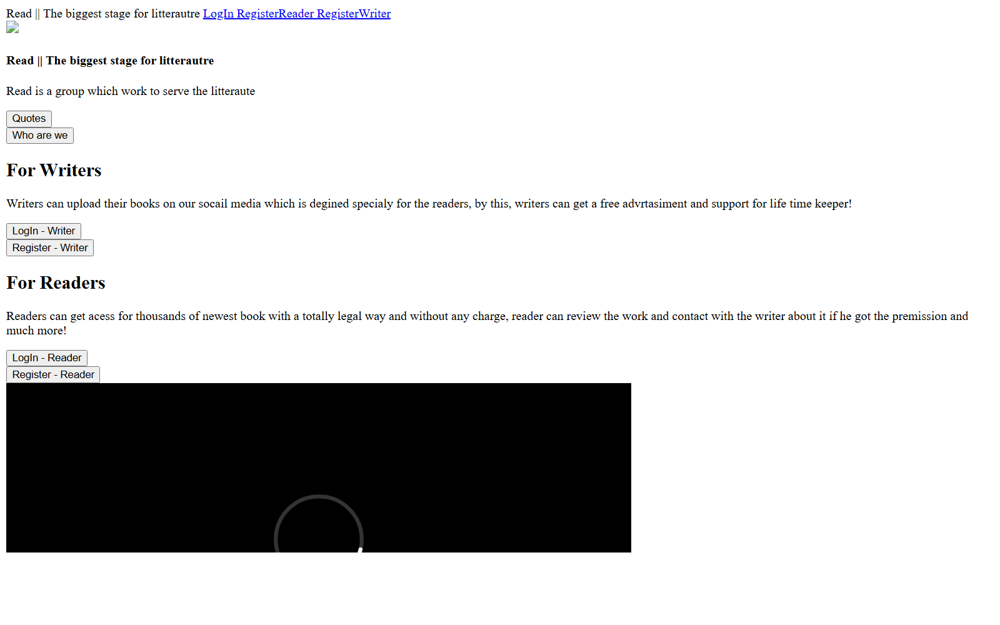 | [Read-](templates/Read-) | Reading platform pages: main page, login, registration and "who are we". Includes a small C# `Program.cs`. | HTML, CSS, Sass |
| 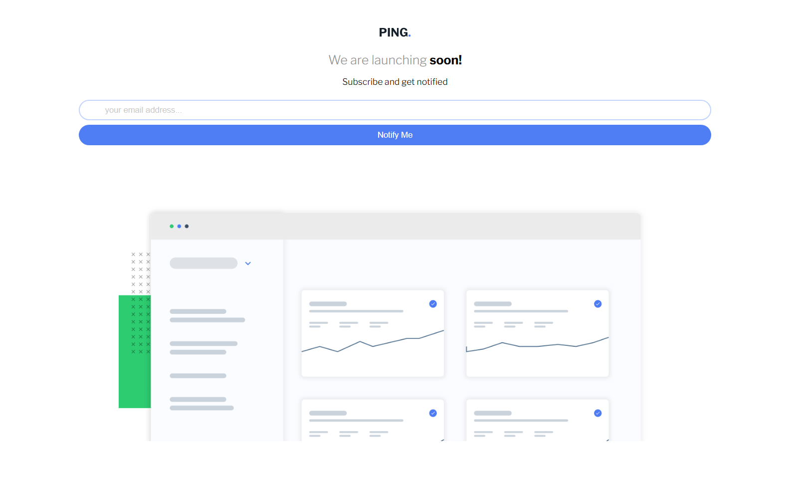 | [ping-coming-soon-page](templates/ping-coming-soon-page) | Coming-soon page with an email sign-up form. Frontend Mentor challenge. | HTML, CSS, JS |
| 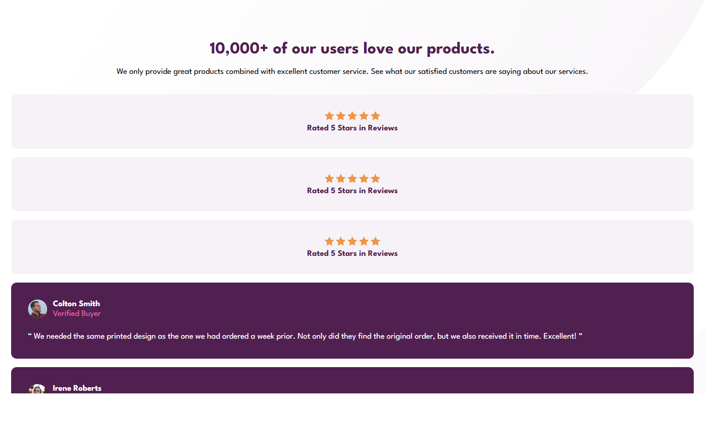 | [Social-proof-section](templates/Social-proof-section) | Social proof section with customer testimonials. Frontend Mentor challenge. | HTML, CSS |

## Components

| Preview | Project | Summary | Stack |
|---|---|---|---|
| 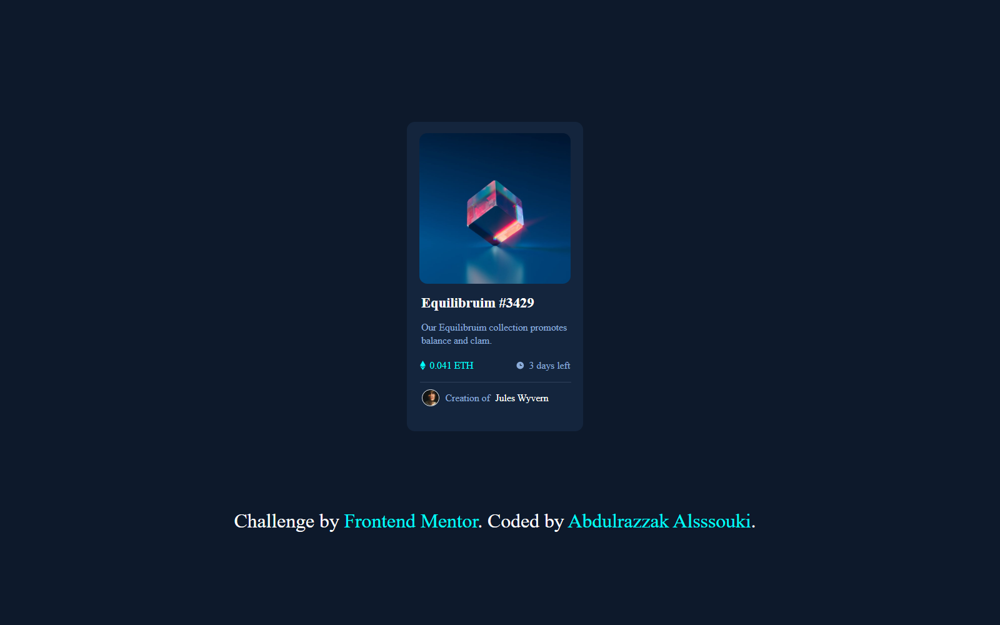 | [NFT-preview-card-component](components/NFT-preview-card-component) | NFT preview card. Frontend Mentor challenge. | HTML, Sass |
| 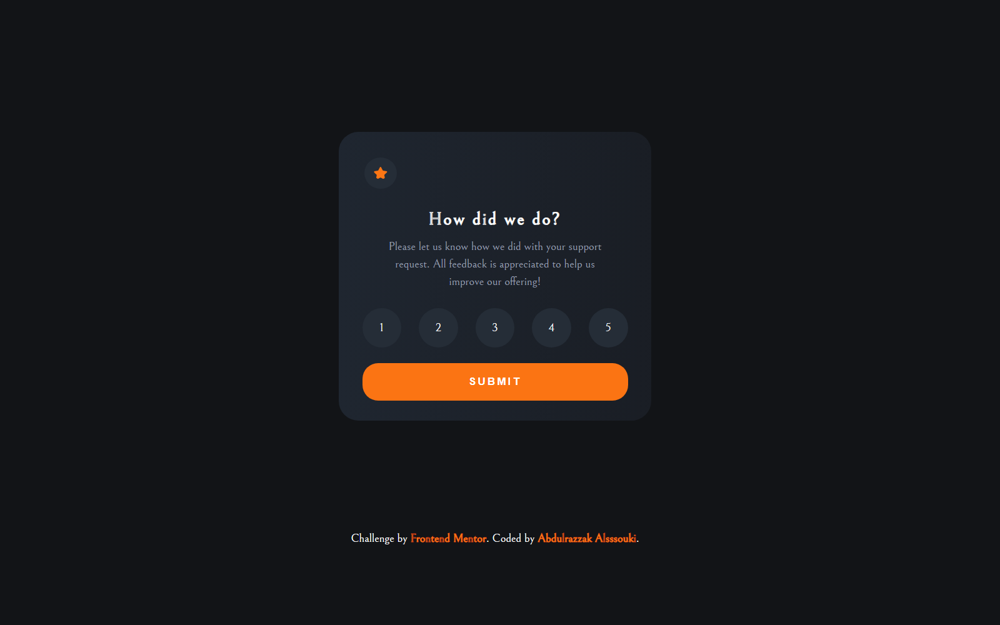 | [Interactive-rating-component](components/Interactive-rating-component) | Rating card that switches to a thank-you state once a score is submitted. Frontend Mentor challenge. | HTML, CSS, JS |
| 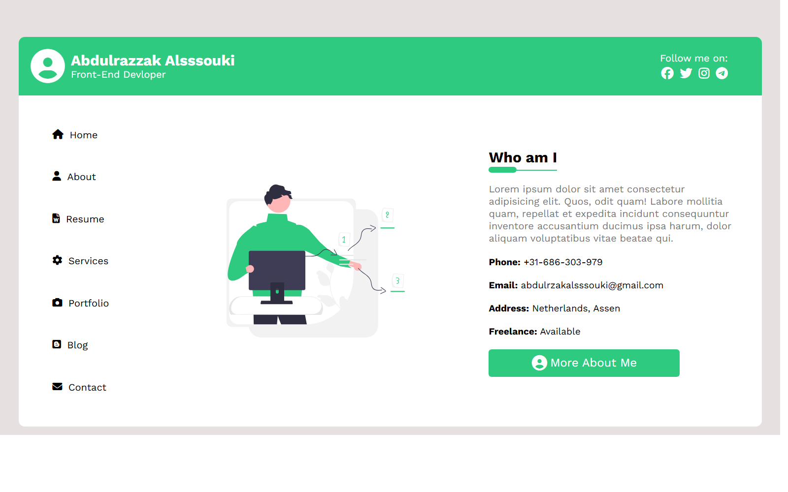 | [User-Card](components/User-Card) | Personal profile card ("Who am I"). | HTML, CSS |
| 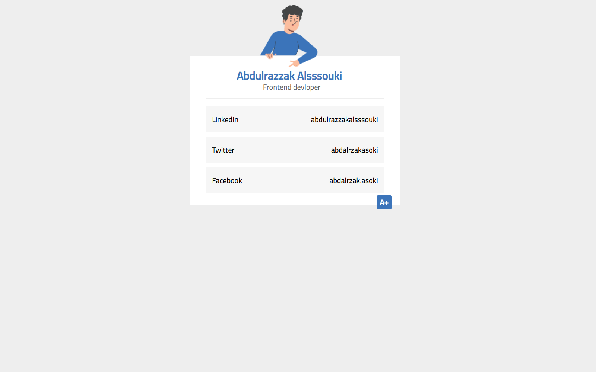 | [social_media_form](components/social_media_form) | Social media sign-up form. | HTML, CSS |
| 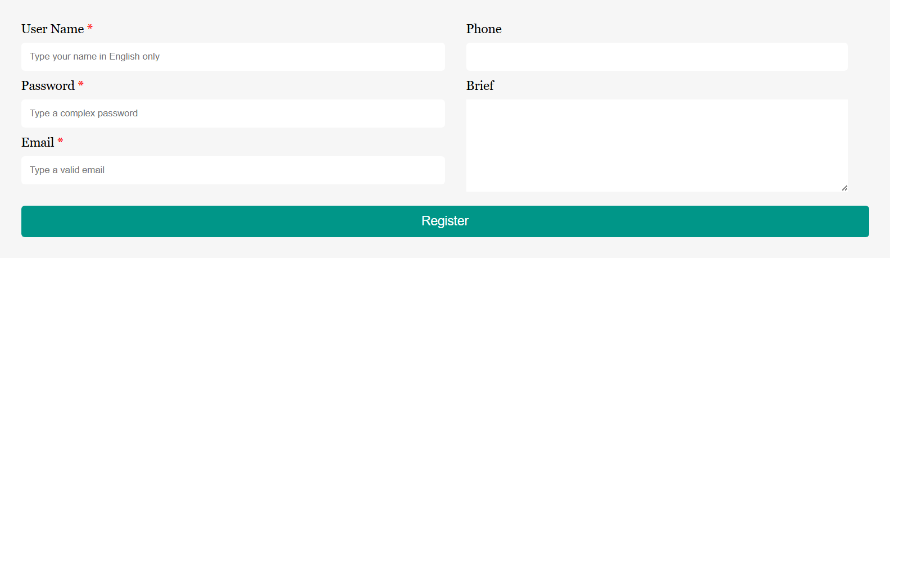 | [register_form](components/register_form) | Simple registration form. | HTML, CSS |
|  | [Bitcoine_dashbored](components/Bitcoine_dashbored) | Bitcoin dashboard layout. | HTML, CSS |
| | [todo_list](components/todo_list) | Todo list app with add and list views plus an About page. | React |

## Apps

| Project | Summary | Stack |
|---|---|---|
| [MovieScope](apps/MovieScope) | Browse and look up movie information. | React, TypeScript, Vite |
| [UTrack](apps/UTrack) | Look up IP address geolocation. | Next.js, TypeScript |
| [Ecommerce](apps/Ecommerce) | Online shop front end with categories, product details and a favourites list. | React |
| [searchApp](apps/searchApp) | Search application built with Create React App. | React |
| [Reactor](apps/Reactor) | "Post Reacting" CRUD app. | React, Vite |
| [Advice-generator-app](apps/Advice-generator-app) | Fetches and shows a random piece of advice. Frontend Mentor challenge. | React |
| [Vue-weather](apps/Vue-weather) | Weather application. | Vue 3, Vite |

---

## History

Every folder keeps the commit history of its original repository (`git log -- templates/Kasper-Template`). The original repositories are archived on GitHub.
